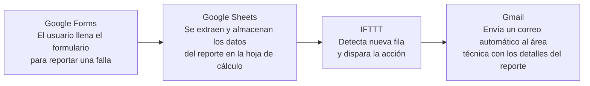

# Automatización: Notificación de Fallas en Computadores

**Manual de uso del flujo IFTTT**  
**Institución:** Centro de Formación Integral San Camilo  
**Realizado por:** Jahir Sebastian Diaz Rodriguez

---

## Tabla de Contenido

1. [Objetivo del manual](#objetivo-del-manual)
2. [Introducción](#introducción)
3. [¿Qué es IFTTT?](#qué-es-ifttt)
4. [Materiales y herramientas necesarias](#materiales-y-herramientas-necesarias)
5. [Diagrama de trabajo](#diagrama-de-trabajo)
6. [Paso a paso para la automatización](#paso-a-paso-para-la-automatización)
    - [1. Creación del formulario en Google Forms](#1-creación-del-formulario-en-google-forms)
    - [2. Creación y vinculación de hoja de Google Sheets](#2-creación-y-vinculación-de-hoja-de-google-sheets)
    - [3. Creación del Applet en IFTTT](#3-creación-del-applet-en-ifttt)
7. [Información del proceso](#información-del-proceso)
8. [Conclusiones](#conclusiones)
9. [Páginas de recursos](#páginas-de-recursos)

---

## Objetivo del manual

Brindar una guía clara, visual y práctica para el uso del flujo de automatización creado con **IFTTT**, que permite notificar automáticamente al equipo técnico sobre fallas reportadas en computadores. Este manual busca facilitar la comprensión de su funcionamiento, activación y personalización, permitiendo a cualquier miembro del equipo técnico gestionarlo sin necesidad de conocimientos avanzados en programación o automatización.

---

## Introducción

**IFTTT** es una plataforma de automatización que permite conectar aplicaciones y servicios para que trabajen juntos de forma automática, sin necesidad de programar. En este caso, se ha utilizado para integrar **Google Forms**, **Google Sheets** y **Gmail** con el fin de automatizar la notificación de fallas en computadores.

---

## ¿Qué es IFTTT?

**IFTTT** significa *If This Then That* (**"Si esto, entonces aquello"**).

* **Fecha de creación:** Fue creado en el año 2010.
* **¿Qué es?** Es una plataforma en línea que permite automatizar tareas conectando diferentes aplicaciones y servicios.
* **¿Para qué sirve?** Sirve para que, cuando ocurre un evento en una aplicación, se ejecute automáticamente una acción en otra.
* **¿Es gratis?** Cuenta con una versión gratuita y una versión de pago.

---

## Materiales y herramientas necesarias

* **Cuenta de Google:** Para usar Google Forms, Google Sheets y Gmail.
* **Google Forms:** Para la creación del formulario de reporte de fallas.
* **Google Sheets:** Para guardar automáticamente las respuestas del formulario.
* **Gmail:** Correo electrónico por el cual se envían las notificaciones automáticas.
* **Cuenta en IFTTT (gratuita):** Para crear el flujo automatizado entre las herramientas.
* **Navegador web:** Para acceder y configurar todas las herramientas.

---

## Diagrama de trabajo

---

## Paso a paso para la automatización

### 1. Creación del formulario en Google Forms

1. Ingresa a **Google Forms** y crea el *Formulario de Reporte de Fallas de Computadores*.
2. Agrega las preguntas necesarias para que los usuarios reporten la falla de su equipo:
    * Nombre de quien realiza el reporte.
    * Departamento al cual pertenece (Recursos Humanos, Finanzas, Ventas, Marketing, Producción, Tecnología, entre otros).
    * Jefe directo.
    * Equipo que presenta la falla y serial del equipo.
    * Ubicación del equipo y fecha de la falla.
    * Explicación del problema que presenta el equipo.
3. Desde este formulario se generará el enlace que se compartirá con los usuarios para realizar los reportes.

### 2. Creación y vinculación de hoja de Google Sheets

1. Dentro del formulario de Google Forms, dirígete a la pestaña **Respuestas**.
2. Haz clic en **Vínculo a Hojas de cálculo**.
3. Esto creará automáticamente una hoja de **Google Sheets** vinculada donde quedarán registradas todas las respuestas con su marca temporal y cada uno de los campos del formulario.

### 3. Creación del Applet en IFTTT

Un **Applet** es el nombre que IFTTT le da a los procesos de automatización.

1. **Inicio en IFTTT:** Ingresa a [https://ifttt.com/](https://ifttt.com/) y crea una cuenta (puedes iniciar sesión directamente con Gmail o Facebook). Luego, haz clic en **Create**.
2. **Configurar el detonador (*If This*):**
    * Haz clic en **Add** junto a *If This*.
    * En el buscador escribe `Sheets` y selecciona el servicio **Google Sheets**.
    * Escoge la opción **New row added to spreadsheet** (indica a IFTTT que se ha agregado un nuevo registro en la hoja de cálculo).
    * En la pantalla de configuración (*Complete trigger fields*), ubica el campo **Or copy and paste the spreadsheet URL**, pega el enlace de tu hoja de Google Sheets y haz clic en **Create trigger**.
3. **Configurar la acción (*Then That*):**
    * Haz clic en **Add** junto a *Then That*.
    * Busca y selecciona el servicio **Gmail** (agrega la cuenta y otorga los permisos necesarios).
    * Selecciona la acción **Send an email** (permite enviar el correo hasta a 20 destinatarios).
    * Completa los campos requeridos:
        * **To address:** Correo(s) del equipo técnico destinatario.
        * **CC / BCC address:** *(Opcional)* Correos en copia.
        * **Subject:** Título del correo.
        * **Body:** Cuerpo del mensaje que se va a enviar.
        * **Attachment URL:** *(Opcional)* Enlace para incluir como adjunto.
        * *Nota:* Al hacer clic en **Add ingredient**, IFTTT reconoce las columnas de tu hoja de Google Sheets, permitiendo personalizar el correo automáticamente con las respuestas del formulario.
    * Haz clic en **Create action**.
4. **Finalizar:** Con ambas condiciones configuradas (*If* y *Then*), haz clic en **Continue** para crear y activar el Applet. A partir de ese momento, se enviarán correos automáticos cada vez que una persona diligencie el formulario de reporte.

---

## Información del proceso

### ¿Qué se soluciona con este Applet?
En el proceso de mantenimiento correctivo de computadores, el reporte manual de fallas genera retrasos y errores en el registro. Este sistema automático registra las fallas de forma inmediata para agilizar la atención y el seguimiento.

### ¿Por qué usar Gmail, Google Forms y Google Sheets?
* **Gmail:** Aprovecha su integración y uso masivo para enviar y recibir los reportes de los usuarios de manera automática.
* **Google Sheets:** Funciona como base de datos donde se registran los reportes recibidos, permitiendo su consulta, organización y análisis sin intervención manual.

---

## Conclusiones

* **Utilidad de la automatización:** La integración con IFTTT optimiza el registro y seguimiento de fallas en equipos de cómputo, reduciendo tiempos de respuesta y errores manuales, y asegurando un historial claro y accesible para soporte y auditorías futuras.
* **Posibles mejoras:** Al depender de conexión a internet y de la estabilidad de Gmail y Sheets, en el futuro se podría desarrollar un sistema propio para brindar una intervención inmediata ante caídas de la plataforma, además de retroalimentar el formulario con más preguntas para obtener reportes más robustos.
* **Aplicabilidad en el mundo real:** La automatización puede aplicarse a cualquier ámbito, desde tareas cotidianas (como programar el encendido de luces al llegar a casa) hasta entornos empresariales como el expuesto en este manual.

---

## Páginas de recursos

* [IFTTT - Explorar integraciones](https://ifttt.com/explore)
* [Google Forms](https://docs.google.com/forms/u/0/)
* [Google Sheets](https://docs.google.com/spreadsheets/u/0/)